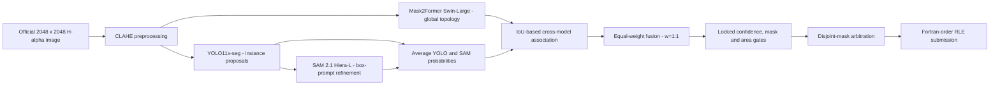

# FINAL DRAFT
## Reproducible 0.40-PQ Solar Filament Instance Segmentation

**Competition:** [Solar Filament Segmentation Challenge 2026](https://www.kaggle.com/competitions/filament-segmentation-2026)  
**Verified public leaderboard score:** **0.40 PQ**  
**Private source repository:** [github.com/kulharshit21/solar-filament-final-draft](https://github.com/kulharshit21/solar-filament-final-draft)  
**Weights, manifests, and exact submission:** [Google Drive - Weights Competion Submmsion](https://drive.google.com/open?id=1qikTNZkhUWEC3vB0Yz2_5l5Zwr1AehFN)  
**Canonical submission SHA-256:** `4ee79cb588f9415eb2f48ebb1a129382f0d7f5e6410724be8b9f6b213b18e512`

This repository is the code-only release for the exact historical pipeline whose submission scored **0.40** on Kaggle. The recovered CSV was independently resubmitted on 10 November 2026 under the description `FINAL DRAFT exact recovered 0.40 w1:1 champion SHA256 4ee79cb5`; Kaggle returned status `COMPLETE` and public score `0.40`.

The model binaries and competition CSV are intentionally not stored in GitHub. They are maintained separately in the linked Drive release with SHA-256 manifests and a 100-pass weight-integrity report.

---

## 1. Problem and evaluation target

The task is **instance segmentation** of solar filaments in 2048 x 2048 H-alpha observations. A successful system must both find each filament and delineate its complete, often thin and curved, morphology.

The competition uses Panoptic Quality:

```text
PQ = SQ x RQ

SQ = sum(IoU of matched pairs) / TP
RQ = TP / (TP + 0.5 FP + 0.5 FN)
```

A prediction and ground-truth instance match only when IoU reaches the evaluator's matching threshold. This makes fragmentation, over-merging, false positives, missed narrow spines, and overlapping predictions particularly costly. The training annotations include multiple human views, so the final method optimizes complete-instance recognition and conservative consensus rather than raw pixel recall alone.

---

## 2. Final architecture

The final system is a calibrated three-model pipeline. YOLO supplies high-resolution instance proposals, Mask2Former supplies global shape understanding, and SAM 2.1 refines proposal boundaries. The final score improvement from 0.39 to 0.40 came from the **locked selector and fusion policy**, not from replacing the archived weights.



### 2.1 Preprocessing

- Input resolution: 2048 x 2048 grayscale.
- Contrast normalization: CLAHE with clip limit `2.0` and tile grid `8 x 8`.
- Identical preprocessing is used for training and test inference.
- Grayscale images are repeated into three channels for ImageNet-pretrained backbones.
- Train/validation grouping uses the `YYYYMMDD` date prefix to reduce temporal leakage.

### 2.2 YOLO11x-seg branch

Purpose: high-resolution instance localization and strong recall for long, thin structures.

- Architecture: YOLO11x instance segmentation.
- Historical champion: 77-epoch full-data checkpoint.
- Reported performance: mask mAP50 `0.788`, box mAP50 `0.792`, precision `0.722`.
- Optimizer: AdamW with cosine learning-rate decay.
- Augmentations: horizontal/vertical flips, rotation, translation, scale, mosaic, copy-paste, and mild HSV changes.
- Inference floor: confidence `0.05`, IoU NMS `0.60`, at most 300 detections.
- TTA: original, horizontal flip, and vertical flip.
- TTA masks are inverse-transformed and associated by IoU.

The branch emits cropped probability maps, confidence scores, boxes, and source metadata instead of committing immediately to binary masks.

### 2.3 Mask2Former branch

Purpose: recover global filament topology and avoid local fragmentation.

- Architecture: Mask2Former universal segmentation with Swin-Large backbone.
- Initialization: COCO instance-segmentation checkpoint.
- Foreground classes: one (`filament`) plus no-object.
- Input size: 1280 x 1280.
- Batch size: 1 with gradient accumulation of 8.
- Epochs: 30.
- Decoder learning rate: `1e-4`; backbone learning rate: `1e-5`.
- Optimizer: AdamW, weight decay `0.05`, gradient clip `0.01`.
- Rotation augmentation: +/-15 degrees.
- Validation: official-style held-out PQ every three epochs.
- Inference TTA: original and horizontal flip.
- Query filtering: class probability at least `0.05`, at most 60 queries.

Mask logits are bilinearly restored to 2048 x 2048 and converted into scored candidate probability maps. Scores combine query class probability and average probability inside predicted support.

### 2.4 SAM 2.1 boundary-refinement branch

Purpose: recover continuous filament spines and barbs around an existing candidate without turning SAM into an unconstrained detector.

- Architecture: SAM 2.1 Hiera-Large.
- Image encoder and prompt encoder: frozen.
- Trainable component: mask decoder only.
- Prompt: candidate box inside a square context crop.
- Crop resolution: 1024 x 1024.
- Training context: `1.3` to `2.0` times box side; inference context: `1.6`.
- Minimum crop side: 256 pixels; box jitter: `0.10` during training.
- Epochs: 8.
- Optimizer: AdamW, learning rate `5e-5`, weight decay `0.01`.
- Schedule: OneCycleLR with 5% warm-up.
- Loss: `20 x focal + Dice + IoU-head MSE`.

SAM is applied to cached candidates and retains the source candidate's identity and confidence. It refines boundaries; it does not independently invent test instances.

### 2.5 Candidate fusion

The final variant is:

```text
ens[avg[yolo]|mask2former;w=1:1]
```

Processing order:

1. Match native YOLO and SAM-refined YOLO candidates by source identity.
2. Average their local probability maps to produce `avg[yolo]`.
3. Associate `avg[yolo]` with Mask2Former candidates using IoU `>= 0.50`.
4. Fuse the two model families with equal weight.
5. Treat a missing model vote as zero; the score threshold becomes a cross-model agreement gate.
6. Apply the locked selector parameters.
7. Resolve pixel overlaps before RLE encoding.

### 2.6 Locked 0.40 selector

These values must not be changed when reproducing the confirmed submission:

| Parameter | Final value |
|---|---:|
| Variant | `ens[avg[yolo]|mask2former;w=1:1]` |
| Mask probability threshold | `0.45` |
| Candidate score threshold | `0.53` |
| Minimum area | `319` pixels |
| Maximum area | `70,502` pixels |
| Fusion association IoU | `0.50` |
| DenseCRF | disabled |
| Overlap policy | disjoint arbitration |

This selector produced 1,261 final instances across all 180 test images with zero overlapping instance pixels.

---

## 3. Training and validation procedure

### Step 1 - Integrity preflight

`scripts/00_verify.py` checks official image counts, train/test disjointness, content-hash disjointness, training annotations, forbidden leakage-like filenames, training-derived area statistics, and GPU inventory.

### Step 2 - Data preparation

`scripts/01_prepare.py` groups observations by date, creates five group-aware folds, computes training-only area statistics, applies CLAHE, generates per-annotator-view labels, and creates model working directories.

### Step 3 - YOLO training

`scripts/02_train_yolo.py` supports a held-out-fold OOF model and a full-data blind-test model, high-resolution augmentation, cosine decay, single-GPU or DDP execution, and best-checkpoint retention.

### Step 4 - Mask2Former training

`scripts/03_train_mask2former.py` rasterizes annotator views with pycocotools, trains backbone and decoder with separate rates, uses gradient accumulation and bfloat16 on CUDA, evaluates official-style PQ, and saves the best checkpoint.

### Step 5 - SAM decoder fine-tuning

`scripts/04_train_sam2.py` creates jittered box-prompt crops, freezes the image and prompt encoders, trains the mask decoder, validates mean IoU, and saves the best decoder state.

### Step 6 - Candidate caching

`scripts/05_predict.py` runs YOLO, Mask2Former, SAM-refined YOLO, and optionally SAM-refined Mask2Former inference. Each image-level cache stores compact probability maps, boxes, scores, source names, and stable candidate indices. This separates expensive neural inference from fast threshold calibration.

### Step 7 - OOF calibration

`scripts/06_select_and_submit.py` evaluates native, SAM-refined, averaged, and ensemble variants with the exact multi-annotator evaluator. It sweeps mask thresholds, confidence thresholds, area policies, fusion weights, and optional DenseCRF. Selection is performed only on training-derived OOF predictions and favors a stable plateau over a one-point spike.

### Step 8 - Locked final generation

`scripts/generate_w11.py` applies the confirmed selector to complete test caches, converts final masks to Fortran-order RLE, verifies all 180 stems, checks RLE decodability, IDs and overlaps, and writes `submission_w11_champion.csv`.

---

## 4. Validation evidence

### OOF evidence recorded by the recovered package

| Metric | Value |
|---|---:|
| OOF PQ | `0.4622` |
| OOF SQ | `0.6857` |
| OOF RQ | `0.6741` |
| OOF TP / FP / FN | `1,031 / 454 / 543` |

### Canonical test submission checks

| Check | Result |
|---|---:|
| Images represented | `180 / 180` |
| Total instances | `1,261` |
| Mean / median instances per image | `7.0056 / 7` |
| Maximum instances per image | `17` |
| Overlapping pixels | `0` |
| Undecodable RLEs | `0` |
| Duplicate filament IDs | `0` |
| Kaggle public PQ | **`0.40`** |

### Independent leaderboard reconfirmation

```text
Description: FINAL DRAFT exact recovered 0.40 w1:1 champion SHA256 4ee79cb5
Status:      COMPLETE
PublicScore: 0.40
Date:        2026-11-10
```

The exact CSV is identified by hash, not by filename alone:

```text
4ee79cb588f9415eb2f48ebb1a129382f0d7f5e6410724be8b9f6b213b18e512
```

---

## 5. Reproduction instructions

### 5.1 Obtain and verify artifacts

Download [Weights Competion Submmsion from Google Drive](https://drive.google.com/open?id=1qikTNZkhUWEC3vB0Yz2_5l5Zwr1AehFN), then run:

```bash
python verify_artifacts.py
```

The release contains the exact weights, canonical CSV, validation report, Kaggle score proof, SHA-256 manifest, and 100-pass verification report. Every released weight was fully read and hashed in 100 consecutive passes: six files, 600 comparisons, zero mismatches.

### 5.2 Install the environment

```bash
python -m venv .venv
source .venv/bin/activate        # Linux
# .venv\Scripts\activate         # Windows
python -m pip install --upgrade pip
python -m pip install -r requirements.txt
```

### 5.3 Place official data and models

```text
data/
├── train_images/
├── test_images/
└── annotations_train.json

models/hf/
├── mask2former-swin-large-coco-instance/
└── sam2.1-hiera-large/

work/models/
├── yolo_full.pt
├── mask2former_fold/
├── sam2_fold_decoder.pt
└── sam2_full_decoder.pt
```

Only official competition data may be used. Never place test labels or organizer-only metadata in the workspace.

### 5.4 Preflight and preparation

```bash
python scripts/verify_code_release.py
python scripts/00_verify.py
python scripts/01_prepare.py
```

### 5.5 Full training sequence

```bash
CUDA_VISIBLE_DEVICES=0 python scripts/02_train_yolo.py --mode fold --device 0
CUDA_VISIBLE_DEVICES=0 python scripts/02_train_yolo.py --mode full --device 0
CUDA_VISIBLE_DEVICES=0 python scripts/03_train_mask2former.py --mode fold --device cuda:0
CUDA_VISIBLE_DEVICES=0 python scripts/04_train_sam2.py --mode fold --device cuda:0
```

### 5.6 Fresh test inference

```bash
CUDA_VISIBLE_DEVICES=0 python scripts/05_predict.py --split test --source yolo --overwrite
CUDA_VISIBLE_DEVICES=0 python scripts/05_predict.py --split test --source mask2former --overwrite
CUDA_VISIBLE_DEVICES=0 python scripts/05_predict.py --split test --source sam2 --overwrite
```

### 5.7 Generate and verify the final CSV

```bash
python scripts/generate_w11.py
sha256sum submissions/submission_w11_champion.csv
```

Expected canonical hash:

```text
4ee79cb588f9415eb2f48ebb1a129382f0d7f5e6410724be8b9f6b213b18e512
```

If another library version or device produces a different file, compare masks and validate it structurally before spending a Kaggle submission. Equal row count alone does not prove equal segmentation.

---

## 6. Recovery and decision history

1. Audited local and Drive backups for the historical 0.40 code, reports, weights, and CSV.
2. Reconstructed the relationship between the archived weights and `w=1:1` selector.
3. Identified the canonical 1,261-row CSV by SHA-256.
4. Built a newer five-fold pipeline as a separate experiment.
5. The newer experiment showed stronger local nested OOF metrics but scored only `0.38`; it was rejected from FINAL DRAFT.
6. Resubmitted the untouched recovered CSV and reconfirmed `0.40`.
7. Split publication into code-only GitHub and binary/submission Drive releases.
8. Ran 100 complete SHA-256 passes over every released weight.
9. Verified the Drive upload with zero checksum differences.

The 0.40 claim belongs to the specific archived code, thresholds, weights, and CSV documented here—not to the later 0.38 experiment.

---

## 7. Release boundaries

GitHub contains source, configuration, documentation, validation evidence, and verification utilities. It excludes datasets, weights, prediction caches, submission CSVs, credentials, and generated work directories.

Drive contains exact released weights, exact 0.40 CSV, checksum manifests, 100-pass verification evidence, score proof, and the artifact verifier. The competition dataset is not redistributed.

---

## 8. Competition integrity

- Training and calibration use official training data only.
- Blind test images are used only for inference.
- No test labels or organizer-only annotations are consumed.
- Date grouping reduces temporal leakage.
- Explicit guards reject known leakage-like filenames.
- Final thresholds are selected from OOF training predictions, not leaderboard probing.
- The score claim is backed by a completed Kaggle submission and exact hash.

See [INTEGRITY.md](INTEGRITY.md), [ARTIFACTS.md](ARTIFACTS.md), and [KAGGLE_WRITEUP.md](KAGGLE_WRITEUP.md).

---

## 9. Final links

- **Private GitHub:** [solar-filament-final-draft](https://github.com/kulharshit21/solar-filament-final-draft)
- **Weights and exact submission:** [Google Drive](https://drive.google.com/open?id=1qikTNZkhUWEC3vB0Yz2_5l5Zwr1AehFN)
- **Competition:** [filament-segmentation-2026](https://www.kaggle.com/competitions/filament-segmentation-2026)

---

## 10. License

Repository code is under the MIT License. Competition data and third-party pretrained models remain governed by their respective licenses and Kaggle rules.
